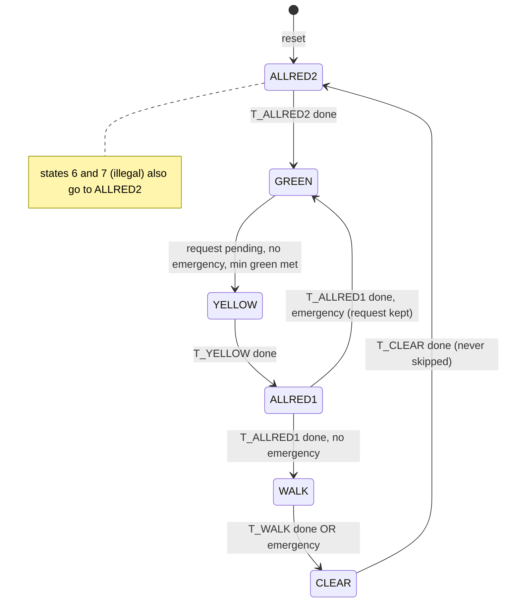

# Functional Specification and Verification Plan

**Project:** Pedestrian Crossing Controller with Safe Emergency Preemption
**Top module for the chip:** `tt_um_ped_crossing_ctrl` (wrapper) → `ped_crossing_ctrl` (design)
**Status:** educational design. Not suitable for real traffic infrastructure.

---

## 1. Application and scope

A **mid-block pedestrian crossing** (zebra crossing with a push button, no junction). A fixed-timer signal stops vehicles even when nobody is waiting; no signal at all is unsafe for pedestrians. This chip is the **sequencing and timing core** of a demand-responsive signal:

* vehicles keep green until a pedestrian actually asks to cross, and always get a **minimum green**;
* the pedestrian request is **captured, acknowledged (`ped_wait`) and served exactly once**;
* an **emergency request never gives an instant green**; it only changes how the safe sequence is finished;
* vehicle permission and pedestrian permission can **never overlap** (checked every clock in simulation).

Out of scope: lamp drivers, sensors, multiple roads, countdown displays, lamp-failure detection, flashing-mode fallback, an independent conflict monitor.

## 2. Interface

| Signal | Dir | Meaning |
|---|---|---|
| `clk` | in | single clock (10 MHz assumed for the chip) |
| `rst_n` | in | active-low reset, asynchronous assert, release assumed synchronous to `clk` |
| `ped_req` | in | pedestrian push button (asynchronous) |
| `emergency_req` | in | emergency preemption request (asynchronous, level) |
| `vehicle_red/yellow/green` | out | vehicle lamps (exactly one is on) |
| `ped_walk` | out | pedestrians may start crossing |
| `ped_clear` | out | pedestrian clearance: do not start, finish crossing |
| `ped_stop` | out | pedestrians must not cross |
| `ped_wait` | out | request registered, waiting for WALK |
| `emergency_active` | out | synchronized emergency request is asserted |
| `state_dbg[2:0]` | out | FSM state (debug) |

Tiny Tapeout pin map: `ui[0]=ped_req`, `ui[1]=emergency_req`; `uo[7:0] = {emergency_active, ped_wait, ped_stop, ped_clear, ped_walk, green, yellow, red}`; `uio[2:0]=state_dbg`.

## 3. Clock, reset and input synchronization

* One clock domain.
* **Why synchronize:** `ped_req` and `emergency_req` come from outside and can change at any instant relative to `clk`. A flip-flop that samples a signal during its setup/hold window can go **metastable** (output neither 0 nor 1 for a while). Two flip-flops in series give the first one a full clock period to settle before the logic sees the value.
* `ped_req` → 3 flops (`s1`, `s2`, `s3`). `s2 & ~s3` is a **rising-edge pulse**: one pulse per press, so a **held** button counts once.
* `emergency_req` → 2 flops; the result is used as a **level**.
* Minimum pulse width: one full clock period (shorter pulses may be missed). The push button is assumed debounced externally.
* **Reset:** all flops reset asynchronously. After reset the FSM is in `ALLRED2` (all red, pedestrians stop) for `T_ALLRED2`, then goes to GREEN. Start-up through an all-red phase is deliberate: the controller never powers up showing green.

## 4. Timing parameters

One **tick** = `CLK_DIV` clocks (10 000 000 clocks = 1 s at 10 MHz). Every timed phase lasts **exactly** `T_xxx × CLK_DIV` clocks (the prescaler restarts on every state change).

| Parameter | Chip value | Meaning |
|---|---|---|
| `T_GREEN` | 20 s | **minimum** vehicle green (can last longer) |
| `T_YELLOW` | 3 s | vehicle yellow |
| `T_ALLRED1` | 2 s | all red before WALK |
| `T_WALK` | 7 s | pedestrian walk |
| `T_CLEAR` | 10 s | pedestrian clearance |
| `T_ALLRED2` | 2 s | all red before vehicles resume |

Simulation uses `CLK_DIV=4` and different values per phase (5/2/3/4/5/2 ticks) so that a mixed-up duration is detected. Limit: durations must be ≤ 62 ticks (6-bit tick counter).

## 5. FSM states and outputs (Moore: outputs depend only on the state)

| Code | State | Vehicle | Pedestrian | Duration |
|---|---|---|---|---|
| 0 | `ALLRED2` (reset state) | red | stop | `T_ALLRED2` |
| 1 | `GREEN` | green | stop | ≥ `T_GREEN`, then until a request is served |
| 2 | `YELLOW` | yellow | stop | `T_YELLOW` |
| 3 | `ALLRED1` | red | stop | `T_ALLRED1` |
| 4 | `WALK` | red | **walk** | `T_WALK`, or less if emergency |
| 5 | `CLEAR` | red | **clear** | `T_CLEAR` (never skipped) |
| 6, 7 | illegal | red | stop | one clock, then → `ALLRED2` |

Every output is assigned in every state (defaults to all-red / ped-stop), so no latches.

## 6. Transition table

| From | Condition | To |
|---|---|---|
| `ALLRED2` | phase timer done | `GREEN` |
| `GREEN` | `ped_pending` ∧ ¬emergency ∧ min-green met | `YELLOW` |
| `YELLOW` | phase timer done | `ALLRED1` |
| `ALLRED1` | timer done ∧ ¬emergency | `WALK` |
| `ALLRED1` | timer done ∧ emergency | `GREEN` (WALK skipped; request kept) |
| `WALK` | timer done **or** emergency | `CLEAR` |
| `CLEAR` | timer done | `ALLRED2` |
| illegal (6, 7) | always | `ALLRED2` |

**Safe signal transitions.** The only way from vehicle go (GREEN/YELLOW) to pedestrian permission (WALK/CLEAR) is through `YELLOW → ALLRED1`. The only way back is through `CLEAR → ALLRED2`. Vehicle green can only be entered from an all-red state (`ALLRED2` or `ALLRED1`). An emergency therefore **never** produces an immediate green.

## 7. Request handling rules

**Pedestrian request**
* Captured on the rising edge of the synchronized button, in any state except `WALK` and `CLEAR` (a press there is ignored: that group is already being served).
* Held in `ped_pending`; shown on `ped_wait`.
* Cleared when `WALK` starts (the cycle `ALLRED1 → WALK`). **If a press and the WALK start fall in the same clock, the clear wins** (the press is considered served).
* A button held down is **one** request; it must be released and pressed again for another.
* A pending request survives an emergency (`ALLRED1 → GREEN` path and emergency hold in GREEN).
* Reset clears it.

**Emergency request** (level, synchronized)
* `GREEN`: GREEN is held while it is asserted. A pending request waits; when the emergency ends and min green is met, the normal cycle starts.
* `YELLOW`: no effect on yellow; continues to `ALLRED1`, then skips WALK and returns to GREEN.
* `ALLRED1`: at the end of the phase goes to GREEN instead of WALK.
* `WALK`: ends WALK immediately → `CLEAR`.
* `CLEAR`, `ALLRED2`: no effect on timing.
* **Simultaneous pedestrian + emergency:** emergency wins; the pedestrian request is kept and served afterwards.
* Time spent in GREEN during the emergency counts toward minimum green (so the pending request is served right after the emergency ends).

## 8. Counter rollover and boundaries

* Prescaler `pre` counts `0 … CLK_DIV-1`, restarts on every state change.
* `cnt` counts ticks since entering the state, **saturates at 63** (no rollover); only GREEN waits for `cnt ≥ T_GREEN`.
* A timed phase ends on the clock where `tick ∧ cnt == T-1` → exactly `T × CLK_DIV` clocks.
* Each state change restarts both counters, so a phase can never inherit a partial count.

## 9. Invalid-state recovery

States 6 and 7 are unreachable in normal operation. If a fault (e.g. a bit-flip) puts the FSM there, outputs are all-red/ped-stop and the next clock goes to `ALLRED2`. Tested in simulation by forcing the state register.

## 10. Safety rules (checked every clock by the testbench)

1. `(vehicle_green | vehicle_yellow)` and `(ped_walk | ped_clear)` are never both true.
2. Exactly one vehicle lamp is on; exactly one of walk/clear/stop is on.
3. Only legal state transitions occur.
4. GREEN is never left while an emergency is asserted, or without a pending request, or before min green.
5. `ped_wait` equals an independent scoreboard model of the request rules.

## 11. Encoding choice

* **Binary (3 flops)** — fewest flops; output decode needs a few gates. Illegal codes exist (6, 7) and need explicit recovery.
* **One-hot (6 flops)** — each state has its own flop, decode is trivial, but there are more flops and illegal combinations are many.
* **Choice: binary**, because the FSM is tiny and the 6-state / 3-bit fit is natural. This is a design-style choice, not a measured PPA claim. In synthesis, Yosys did not re-encode the FSM because the state register drives the `state_dbg` output.

## 12. Assumptions that were applied (decisions D1–D7)

Applied as defaults because the project deadline did not allow waiting for answers; change them only with a matching change to RTL + testbench.

| ID | Decision |
|---|---|
| D1 | Emergency = hold vehicle GREEN (reached through the safe sequence). |
| D2 | Emergency during WALK ends WALK immediately; CLEAR is never skipped. |
| D3 | Separate `ped_clear` output (no blinking). |
| D4 | Durations 20 / 3 / 2 / 7 / 10 / 2 s. |
| D5 | Latched, edge-captured request; cleared at WALK start; ignored during WALK/CLEAR. |
| D6 | Emergency wins; the pedestrian request is kept. |
| D7 | 10 MHz clock. |

## 13. Verification plan and results

Testbench: `verification/tb_ped_crossing_ctrl.v` — self-checking, uses short timing (1 tick = 4 clocks). Monitors run on every clock: output decode per state, safety rules, legal transitions, exact phase durations, min green, emergency rules, request scoreboard, liveness (a pending request must be served).

| ID | Scenario | Stimulus | Expected | Pass condition |
|---|---|---|---|---|
| T01 | Reset values, start-up | reset low, then release | state `ALLRED2`, red + stop, no wait/emergency; GREEN after exactly `T_ALLRED2×DIV` clocks | outputs match, count = 8 |
| T02 | Idle | no inputs for 60 clocks | stays GREEN | state constant |
| T03 | Normal cycle | 1-clock press | wait lights; Y → AR1 → WALK (wait clears) → CLEAR → AR2 → GREEN | order, outputs, durations exact |
| T04 | Press early in GREEN | press right after GREEN starts | stays GREEN until min green met, then YELLOW | min-green check |
| T05 | Held button | hold high for whole cycle | one cycle only; release + re-press gives another | no second cycle while held |
| T06 | Pulse alignment | 1-clock pulses at 3 phases vs clock | captured every time | `ped_wait` high |
| T07 | Emergency in GREEN + pending | emergency, then press | GREEN held, request kept, served after release | state GREEN throughout |
| T08 | Simultaneous requests | press + emergency same clock | emergency wins, request kept | GREEN held, then served |
| T09 | Emergency in every phase | assert in YELLOW, ALLRED1, WALK, CLEAR, ALLRED2 | WALK→CLEAR at once; no WALK after emergency; CLEAR full | monitors |
| T10 | Reset in every phase | async reset in all 6 states (with emergency high in some) | all-red, wait/emergency cleared, restart OK | outputs, no stale request |
| T11 | Illegal state | force state 6 and 7 | all-red, then `ALLRED2` | recovery |
| T12 | Press during WALK / CLEAR | press mid-phase | ignored | `ped_wait` stays 0, no 2nd cycle |
| T13 | Boundary sweep | 2nd press at every clock 0…80 after ALLRED1 starts | scoreboard agrees at every clock | 81 runs, 0 mismatches |
| T14 | Emergency sweep | 25-clock emergency started at every 2nd clock of the cycle | all rules hold, returns to idle GREEN | 41 runs |
| T15 | Short emergency | 1-clock emergency during WALK | legal behaviour | monitors |
| MUT | Bug injection | 16 deliberate RTL bugs | testbench must fail for each | 16 / 16 caught |
| SMK | Production timing | default parameters (10 MHz, 1 tick = 10 M clocks) | start-up all-red = 20 000 000 clocks | exact |
| CCT | cocotb tests on the chip wrapper | 6 tests incl. pin mapping | pass | 6 / 6 |

**What simulation can and cannot prove.** Simulation shows the logic behaves correctly for the tested situations. It does **not** prove: exhaustive correctness of all input sequences (that needs formal verification, e.g. SymbiYosys), metastability behaviour of the synchronizers (needs timing analysis/MTBF analysis), post-layout timing, power, or that the chip works physically. Gate-level simulation and static timing analysis are done by the GDS flow, not by this testbench.

## 14. Limitations (educational vs production)

A production controller needs: certified traffic-signal standards compliance, an independent hardware conflict monitor, lamp-failure detection, flashing-mode fallback, battery-backed timing, timing values set by traffic engineers, surge/EMC protection and field testing. This design is a functionally verified RTL block only.
